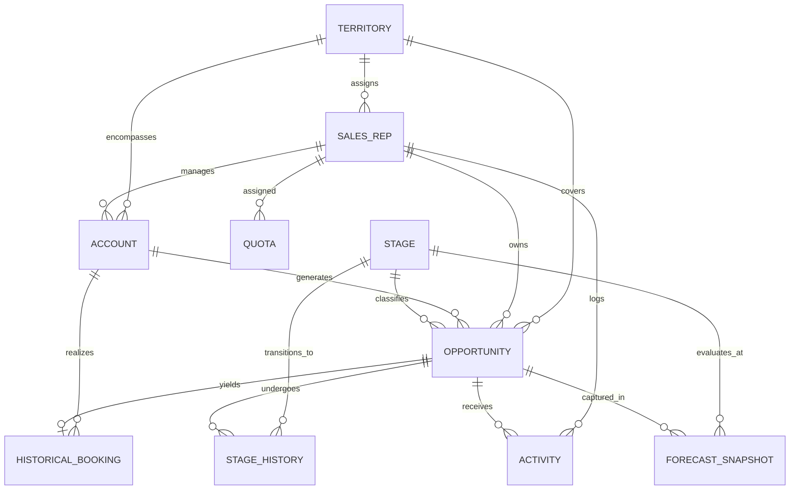

# Enterprise Bookings Forecasting Data Dictionary

This Data Dictionary specifies the data schema, entity relationships, validation constraints, and business domain rules for the end-to-end Opportunity & Bookings Forecasting workflow.

---

## 1. Entity Overview & Cardinality

| Entity | Primary Key | Description | Parent Entity | Cardinality |
| :--- | :--- | :--- | :--- | :--- |
| **Territory** | `territory_id` | Geographic/market segment sales boundary | — | Master (1:N to Reps, Accounts, Deals) |
| **SalesRep** | `rep_id` | Individual quota-carrying or managerial sales agent | Territory | N:1 with Territory, 1:N with Accounts/Deals |
| **Account** | `account_id` | Prospective or existing customer organization | Territory, SalesRep | N:1 with Territory & Rep, 1:N with Deals |
| **Stage** | `stage_id` | Canonical pipeline progression milestones | — | Reference catalog (1:N with Opps/Snapshots) |
| **Opportunity** | `opportunity_id` | Sales deal tracking potential booking value | Account, SalesRep | N:1 with Account & Rep, 1:N with History/Activity |
| **StageHistory** | `stage_history_id` | Immutable state-change log of stage transitions | Opportunity, Stage | N:1 with Opportunity & Stage |
| **Activity** | `activity_id` | Discrete engagement event (call, meeting, demo) | Opportunity, SalesRep | N:1 with Opportunity & Rep |
| **Quota** | `quota_id` | Rep quarterly sales target expectation | SalesRep | N:1 with SalesRep |
| **HistoricalBooking** | `booking_id` | Confirmed closed-won transaction record | Opportunity, Account | 1:1 with Closed-Won Opportunity |
| **ForecastSnapshot** | `snapshot_id` | Periodic time-series freeze of pipeline state | Opportunity, Stage | N:1 with Opportunity & Stage |
| **GroundTruthAnomaly** | `anomaly_id` | Traceable registry of injected anomalies | Source entity | Isolated ground-truth evaluation log |

---

## 2. Granular Field Specifications

### 2.1 Territory (`territories`)
| Field | Type | Required | Allowed Values | Units | Uniqueness | Validation Rule |
| :--- | :--- | :--- | :--- | :--- | :--- | :--- |
| `territory_id` | `VARCHAR(16)` | Required | `TERR-[0-9]{3}` | ID | PK (Unique) | Regex match `^TERR-\d{3}$` |
| `territory_name` | `VARCHAR(64)` | Required | Descriptive name | Text | Unique | Non-empty string |
| `region` | `VARCHAR(32)` | Required | `North America`, `EMEA`, `APAC`, `LATAM` | Categorical | None | Must belong to allowed region enum |
| `segment` | `VARCHAR(32)` | Required | `Enterprise`, `Mid-Market`, `SMB` | Categorical | None | Must belong to allowed segment enum |
| `currency` | `CHAR(3)` | Required | `USD`, `EUR`, `GBP`, `SGD` | ISO 4217 | None | Valid 3-letter currency code |
| `target_growth_rate` | `DECIMAL(5,4)` | Required | `0.0000` to `1.0000` | Ratio | None | Must be between 0.0 and 1.0 (0% - 100%) |

### 2.2 SalesRep (`sales_reps`)
| Field | Type | Required | Allowed Values | Units | Uniqueness | Validation Rule |
| :--- | :--- | :--- | :--- | :--- | :--- | :--- |
| `rep_id` | `VARCHAR(16)` | Required | `REP-[0-9]{6}` | ID | PK (Unique) | Regex match `^REP-\d{6}$` |
| `name` | `VARCHAR(64)` | Required | Rep full name | Text | None | Non-empty string |
| `email` | `VARCHAR(128)` | Required | Valid RFC 5322 email | Text | Unique | Regex email format `^[\w\.-]+@[\w\.-]+\.\w+$` |
| `role` | `VARCHAR(32)` | Required | `Account Executive`, `Senior AE`, `Enterprise AE`, `Sales Manager` | Categorical | None | Valid role enum |
| `territory_id` | `VARCHAR(16)` | Required | Valid `territory_id` | Foreign Key | None | FK referencing `Territory.territory_id` |
| `hire_date` | `DATE` | Required | `2018-01-01` to `2026-10-31` | YYYY-MM-DD | None | Date must not be in future relative to data horizon |
| `base_quota` | `DECIMAL(12,2)` | Required | `200000.00` to `2500000.00` | USD ($) | None | Must be positive; role-proportional |
| `tenure_months` | `INTEGER` | Required | `>= 0` | Months | None | Derived: `DATEDIFF(month, hire_date, as_of_date)` |
| `status` | `VARCHAR(16)` | Required | `Active`, `On Leave`, `Terminated` | Categorical | None | Valid rep status enum |

### 2.3 Account (`accounts`)
| Field | Type | Required | Allowed Values | Units | Uniqueness | Validation Rule |
| :--- | :--- | :--- | :--- | :--- | :--- | :--- |
| `account_id` | `VARCHAR(16)` | Required | `ACC-[0-9]{6}` | ID | PK (Unique) | Regex match `^ACC-\d{6}$` |
| `account_name` | `VARCHAR(128)` | Required | Organization name | Text | Unique | Non-empty string |
| `industry` | `VARCHAR(32)` | Required | `Technology`, `Healthcare`, `Financial Services`, `Manufacturing`, `Retail`, `Energy` | Categorical | None | Allowed industry enum |
| `territory_id` | `VARCHAR(16)` | Required | Valid `territory_id` | Foreign Key | None | FK referencing `Territory.territory_id` |
| `primary_rep_id` | `VARCHAR(16)` | Required | Valid `rep_id` | Foreign Key | None | FK referencing `SalesRep.rep_id` |
| `annual_revenue` | `DECIMAL(14,2)` | Required | `1000000.00` to `5000000000.00` | USD ($) | None | Must be strictly positive |
| `employee_count` | `INTEGER` | Required | `20` to `100000` | Count | None | Must be >= 1 |
| `tier` | `VARCHAR(16)` | Required | `Strategic`, `Tier-1`, `Tier-2`, `Tier-3` | Categorical | None | Derived based on revenue & employee count |
| `created_at` | `DATE` | Required | `2020-01-01` to `2026-10-31` | YYYY-MM-DD | None | Account creation must precede opportunities |

### 2.4 Stage (`stages`)
| Field | Type | Required | Allowed Values | Units | Uniqueness | Validation Rule |
| :--- | :--- | :--- | :--- | :--- | :--- | :--- |
| `stage_id` | `VARCHAR(16)` | Required | `STG-01-PROSPECT`, `STG-02-DISCOV`, `STG-03-PROP`, `STG-04-NEGOT`, `STG-05-WON`, `STG-06-LOST` | ID | PK (Unique) | Standardized enum format |
| `stage_order` | `INTEGER` | Required | `1` to `6` | Sequence | Unique | Sequential integers from 1 to 6 |
| `stage_name` | `VARCHAR(32)` | Required | `Prospecting`, `Discovery`, `Proposal`, `Negotiation`, `Closed Won`, `Closed Lost` | Categorical | Unique | Canonical pipeline stage names |
| `default_probability` | `DECIMAL(3,2)` | Required | `0.10, 0.25, 0.50, 0.75, 1.00, 0.00` | Ratio | None | Must match stage progression probability |
| `is_closed` | `BOOLEAN` | Required | `True`, `False` | Boolean | None | `True` for Won and Lost; `False` for open |
| `is_won` | `BOOLEAN` | Required | `True`, `False` | Boolean | None | `True` ONLY for Closed Won |
| `target_duration_days` | `INTEGER` | Required | `0` to `45` | Days | None | Standard expected time deal remains in stage |

### 2.5 Opportunity (`opportunities`)
| Field | Type | Required | Allowed Values | Units | Uniqueness | Validation Rule |
| :--- | :--- | :--- | :--- | :--- | :--- | :--- |
| `opportunity_id` | `VARCHAR(24)` | Required | `OPP-2026-[0-9]{6}` | ID | PK (Unique) | Regex match `^OPP-\d{4}-\d{6}$` |
| `account_id` | `VARCHAR(16)` | Required | Valid `account_id` | Foreign Key | None | FK referencing `Account.account_id` |
| `rep_id` | `VARCHAR(16)` | Required | Valid `rep_id` | Foreign Key | None | FK referencing `SalesRep.rep_id` |
| `territory_id` | `VARCHAR(16)` | Required | Valid `territory_id` | Foreign Key | None | FK referencing `Territory.territory_id` |
| `product_family` | `VARCHAR(32)` | Required | `Cloud Platform`, `Data & Analytics`, `Security Suite`, `AI & Automation` | Categorical | None | Allowed product catalog enum |
| `deal_type` | `VARCHAR(16)` | Required | `New Logo`, `Expansion`, `Renewal` | Categorical | None | Allowed deal type enum |
| `lead_source` | `VARCHAR(32)` | Required | `Inbound`, `Outbound Rep`, `Partner Referral`, `Event` | Categorical | None | Allowed lead source enum |
| `amount` | `DECIMAL(12,2)` | Required | `5000.00` to `1500000.00` | Currency | None | Deal unweighted contract value |
| `currency` | `CHAR(3)` | Required | `USD`, `EUR`, `GBP`, `SGD` | ISO 4217 | None | Account / Territory baseline currency |
| `amount_usd` | `DECIMAL(12,2)` | Required | Normalized value | USD ($) | None | Derived: `amount * fx_rate` |
| `created_date` | `DATE` | Required | `2024-11-01` to `2026-10-31` | YYYY-MM-DD | None | Must be >= Account `created_at` |
| `expected_close_date` | `DATE` | Required | `created_date` to `2027-06-30` | YYYY-MM-DD | None | Rule: `expected_close_date >= created_date` |
| `actual_close_date` | `DATE` | Optional | Nullable if Open | YYYY-MM-DD | None | If populated, must be >= `created_date` |
| `current_stage_id` | `VARCHAR(16)` | Required | Valid `stage_id` | Foreign Key | None | FK referencing `Stage.stage_id` |
| `status` | `VARCHAR(16)` | Required | `Open`, `Won`, `Lost` | Categorical | None | Won if `current_stage_id = STG-05-WON`, Lost if `STG-06-LOST`, else Open |
| `deal_age_days` | `INTEGER` | Required | `>= 0` | Days | None | Derived: `DATEDIFF(close_date or current_date, created_date)` |
| `slippage_count` | `INTEGER` | Required | `>= 0` | Count | None | Number of times `expected_close_date` was postponed |

### 2.6 StageHistory (`stage_histories`)
| Field | Type | Required | Allowed Values | Units | Uniqueness | Validation Rule |
| :--- | :--- | :--- | :--- | :--- | :--- | :--- |
| `stage_history_id` | `VARCHAR(36)` | Required | `STG-OPP-[0-9]{4}-[0-9]{6}-[0-9]{3}` | ID | PK (Unique) | Deterministic composite ID |
| `opportunity_id` | `VARCHAR(24)` | Required | Valid `opportunity_id` | Foreign Key | None | FK referencing `Opportunity.opportunity_id` |
| `from_stage_id` | `VARCHAR(16)` | Optional | Valid `stage_id` or `NULL` | Foreign Key | None | `NULL` only on initial opportunity creation |
| `to_stage_id` | `VARCHAR(16)` | Required | Valid `stage_id` | Foreign Key | None | FK referencing `Stage.stage_id` |
| `transition_date` | `DATE` | Required | Within deal lifespan | YYYY-MM-DD | None | Chronologically monotonically increasing per deal |
| `days_in_previous_stage`| `INTEGER` | Required | `>= 0` | Days | None | Derived from previous transition date |
| `changed_by_rep_id` | `VARCHAR(16)` | Required | Valid `rep_id` | Foreign Key | None | FK referencing `SalesRep.rep_id` |
| `transition_reason` | `VARCHAR(64)` | Optional | `Standard Qualification`, `Quote Sent`, `Contract Negotiation`, `Budget Cut`, `Competitor Selected` | Text | None | Contextual change reason |

### 2.7 Activity (`activities`)
| Field | Type | Required | Allowed Values | Units | Uniqueness | Validation Rule |
| :--- | :--- | :--- | :--- | :--- | :--- | :--- |
| `activity_id` | `VARCHAR(20)` | Required | `ACT-[0-9]{7}` | ID | PK (Unique) | Regex match `^ACT-\d{7}$` |
| `opportunity_id` | `VARCHAR(24)` | Required | Valid `opportunity_id` | Foreign Key | None | FK referencing `Opportunity.opportunity_id` |
| `rep_id` | `VARCHAR(16)` | Required | Valid `rep_id` | Foreign Key | None | FK referencing `SalesRep.rep_id` |
| `activity_type` | `VARCHAR(32)` | Required | `Call`, `Email`, `Demo`, `Executive Meeting`, `Technical Evaluation` | Categorical | None | Valid activity enum |
| `activity_date` | `DATE` | Required | Between deal create and close | YYYY-MM-DD | None | `created_date <= activity_date <= actual_close_date` |
| `duration_minutes` | `INTEGER` | Required | `5` to `180` | Minutes | None | Must be positive |
| `sentiment_score` | `DECIMAL(3,2)` | Required | `-1.00` to `1.00` | Sentiment Index | None | Continuous score between -1.0 and +1.0 |
| `outcome` | `VARCHAR(16)` | Required | `Completed`, `Rescheduled`, `No Show` | Categorical | None | Activity delivery outcome |

### 2.8 Quota (`quotas`)
| Field | Type | Required | Allowed Values | Units | Uniqueness | Validation Rule |
| :--- | :--- | :--- | :--- | :--- | :--- | :--- |
| `quota_id` | `VARCHAR(32)` | Required | `QUOTA-REP-[0-9]{6}-[0-9]{4}Q[1-4]` | ID | PK (Unique) | E.g., `QUOTA-REP-000001-2026Q1` |
| `rep_id` | `VARCHAR(16)` | Required | Valid `rep_id` | Foreign Key | None | FK referencing `SalesRep.rep_id` |
| `fiscal_quarter` | `CHAR(6)` | Required | `2025Q1` to `2026Q4` | Quarter | None | Valid Fiscal Quarter format `^\d{4}Q[1-4]$` |
| `quota_amount` | `DECIMAL(12,2)` | Required | `50000.00` to `1000000.00` | USD ($) | None | Proportional to role and quarter seasonality |
| `effective_start_date` | `DATE` | Required | First day of quarter | YYYY-MM-DD | None | Standard calendar quarter start |
| `effective_end_date` | `DATE` | Required | Last day of quarter | YYYY-MM-DD | None | Standard calendar quarter end |

### 2.9 HistoricalBooking (`historical_bookings`)
| Field | Type | Required | Allowed Values | Units | Uniqueness | Validation Rule |
| :--- | :--- | :--- | :--- | :--- | :--- | :--- |
| `booking_id` | `VARCHAR(24)` | Required | `BKG-2026-[0-9]{6}` | ID | PK (Unique) | Regex match `^BKG-\d{4}-\d{6}$` |
| `opportunity_id` | `VARCHAR(24)` | Required | Valid `opportunity_id` | Foreign Key | Unique | 1:1 with Won deals. Deal must be `STG-05-WON` |
| `account_id` | `VARCHAR(16)` | Required | Valid `account_id` | Foreign Key | None | Must match `Opportunity.account_id` |
| `rep_id` | `VARCHAR(16)` | Required | Valid `rep_id` | Foreign Key | None | Must match `Opportunity.rep_id` |
| `territory_id` | `VARCHAR(16)` | Required | Valid `territory_id` | Foreign Key | None | Must match `Opportunity.territory_id` |
| `booked_date` | `DATE` | Required | Closed date | YYYY-MM-DD | None | Must equal `Opportunity.actual_close_date` |
| `fiscal_quarter` | `CHAR(6)` | Required | `2025Q1` to `2026Q4` | Quarter | None | Derived from `booked_date` |
| `booking_amount` | `DECIMAL(12,2)` | Required | Deal final amount | USD ($) | None | Derived: equals `Opportunity.amount_usd` |
| `booking_type` | `VARCHAR(24)` | Required | `New ARR`, `Expansion ARR`, `Renewal ARR` | Categorical | None | Mapped from `Opportunity.deal_type` |

### 2.10 ForecastSnapshot (`forecast_snapshots`)
| Field | Type | Required | Allowed Values | Units | Uniqueness | Validation Rule |
| :--- | :--- | :--- | :--- | :--- | :--- | :--- |
| `snapshot_id` | `VARCHAR(32)` | Required | `FCST-[0-9]{4}-[0-9]{2}-[0-9]{2}-[0-9]{3}` | ID | PK (Unique) | E.g. `FCST-2026-01-31-001` |
| `snapshot_date` | `DATE` | Required | Fixed month/quarter dates | YYYY-MM-DD | None | Freeze date; no future data may leak |
| `opportunity_id` | `VARCHAR(24)` | Required | Valid `opportunity_id` | Foreign Key | None | Must refer to deal open as of `snapshot_date` |
| `as_of_stage_id` | `VARCHAR(16)` | Required | Valid `stage_id` | Foreign Key | None | Stage of the deal exactly at `snapshot_date` |
| `as_of_amount` | `DECIMAL(12,2)` | Required | Positive deal value | USD ($) | None | Deal amount known as of snapshot |
| `as_of_close_date`| `DATE` | Required | Expected close date | YYYY-MM-DD | None | Current estimated close date as of snapshot |
| `deal_age_days` | `INTEGER` | Required | `>= 0` | Days | None | Derived: `DATEDIFF(day, opp.created_date, snapshot_date)` |
| `activity_count_last_30d`| `INTEGER` | Required | `>= 0` | Count | None | Derived: Count of activities in `[snapshot_date - 30d, snapshot_date]` |
| `stage_probability`| `DECIMAL(3,2)` | Required | `0.00` to `1.00` | Ratio | None | Must match `Stage.default_probability` unless justified override |
| `weighted_amount` | `DECIMAL(12,2)` | Required | `>= 0` | USD ($) | None | Derived: `ROUND(as_of_amount * stage_probability, 2)` |
| `forecast_category`| `VARCHAR(16)` | Required | `Pipeline`, `Best Case`, `Commit`, `Closed` | Categorical | None | Mapped from stage probability tier |

### 2.11 GroundTruthAnomaly (`ground_truth_anomalies`)
*Note: Maintained strictly separate from feature tables to prevent data leakage during training/forecasting.*
| Field | Type | Required | Allowed Values | Units | Uniqueness | Validation Rule |
| :--- | :--- | :--- | :--- | :--- | :--- | :--- |
| `anomaly_id` | `VARCHAR(24)` | Required | `ANOM-[0-9]{6}` | ID | PK (Unique) | Regex match `^ANOM-\d{6}$` |
| `record_id` | `VARCHAR(36)` | Required | Affected record primary key | ID | None | Exists in source entity table |
| `entity_type` | `VARCHAR(32)` | Required | Entity name (`Opportunity`, `ForecastSnapshot`, etc.) | Categorical | None | Valid entity table name |
| `issue_type` | `VARCHAR(64)` | Required | Enum of 5 mandatory edge cases:  1. `Forecast uses final outcome data` 2. `Stage probability inconsistent with snapshot` 3. `Duplicate opportunity counted` 4. `Close date before creation` 5. `Currency totals mixed` | Categorical | None | Strictly matches edge case taxonomy |
| `injected_field` | `VARCHAR(32)` | Required | Target corrupted column | Text | None | Valid column in target entity |
| `expected_clean_value`| `TEXT` | Required | Uncorrupted expected state | Text | None | Ground-truth reference value |
| `observed_corrupt_value`| `TEXT` | Required | The injected invalid value | Text | None | Evaluated target value |
| `detection_rule` | `VARCHAR(32)` | Required | Rule identifier (e.g. `RULE-LEAKAGE-01`, `RULE-CHRONO-01`) | ID | None | Corresponds to validator rule |

---

## 3. Data Integrity & Lifecycle Rules

1. **Temporal Precedence**:
   $$\text{SalesRep.hire\_date} \le \text{Account.created\_at} \le \text{Opportunity.created\_date} \le \text{StageHistory.transition\_date} \le \text{actual\_close\_date}$$
2. **Forecast Time-Consistency (Anti-Leakage)**:
   A snapshot taken at timestamp $T_{\text{snapshot}}$ may only inspect stage transitions and activities occurring at or prior to $T_{\text{snapshot}}$. It MUST NOT reference future transitions, actual outcomes, or actual close dates beyond $T_{\text{snapshot}}$.
3. **Reconciliation Invariant**:
   $$\text{Weighted Pipeline} = \sum_{i \in \text{Open Opps}} (\text{as\_of\_amount}_i \times \text{stage\_probability}_i)$$
4. **Historical Bookings Integrity**:
   Every record in `HistoricalBooking` MUST correspond 1:1 with an `Opportunity` where `current_stage_id = 'STG-05-WON'`. Non-won opportunities cannot produce bookings.
