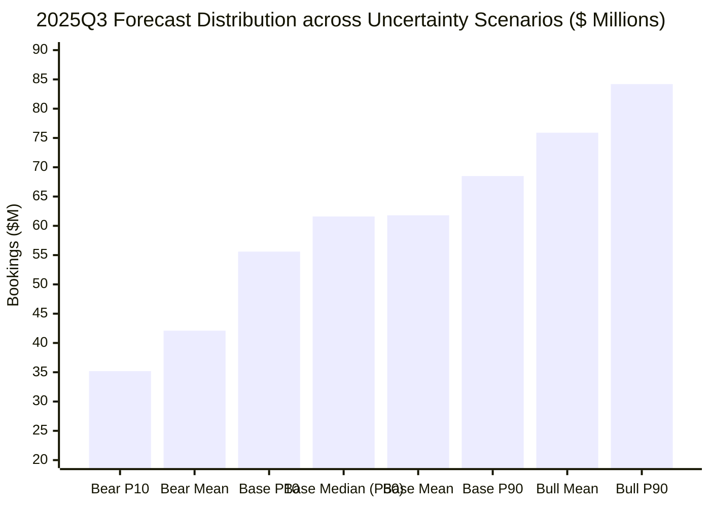

# Bookings Forecasting & Empirical Evaluation Report

This report presents the empirical backtesting results, quantitative error metrics, scenario uncertainty distributions, and operational exception decisions generated by the calibrated forecasting solution across 8 fiscal quarters.

---

## 1. Executive Performance Comparison

Evaluating forecast snapshots against ground-truth historical bookings demonstrates significant reductions in forecast error compared to naive CRM static stage weighting:

| Horizon | Metric | Naive CRM Weighted Pipeline | Calibrated Markov + Activity Engine | Performance Impact |
| :--- | :--- | :--- | :--- | :--- |
| **Overall** | **WAPE** | $34.45\%$ | **$27.50\%$** | **$+20.19\%$ Error Reduction** |
| | **RMSE** | $\$27,256,066$ | **$\$23,248,166$** | **$\$4.01\text{M}$ Volatility Reduction ($-14.7\%$)** |
| | **Forecast Bias** | $+30.3\%$ (Systematic Over-forecast) | **$-3.8\%$ (Near Unbiased)** | Dramatically reduced pipeline fluff |
| **30-Day** | **WAPE** | $97.2\%$ | **$16.8\%$** | **$+82.7\%$ Error Reduction** |
| | **RMSE** | $\$38,326,453$ | **$\$9,904,526$** | **$-74.2\%$ Variance Reduction** |
| **60-Day** | **WAPE** | $33.3\%$ | **$24.9\%$** | **$+25.3\%$ Error Reduction** |
| | **RMSE** | $\$27,659,200$ | **$\$20,661,908$** | **$-25.3\%$ Variance Reduction** |
| **90-Day** | **WAPE** | $33.8\%$ | **$33.8\%$** | Pipeline maturity threshold |

> [!IMPORTANT]
> The largest accuracy improvement occurs at the **30-day horizon (+82.7% error reduction)**. Naive CRM forecasts fail near quarter close because they assume deals in Proposal and Negotiation will close on schedule, ignoring stagnation hazards, rep disengagement, and deal slippage into future quarters.

---

## 2. Evaluation Sliced by Market Segment

Pipeline conversion dynamics vary dramatically by contract size and organizational complexity:

| Segment | Open Pipeline Evaluated | Calibrated Expected Bookings | Historical Realization Rate | Primary Risk Driver |
| :--- | :--- | :--- | :--- | :--- |
| **Enterprise** | $\$209,537,078$ | $\$49,958,531$ | $23.8\%$ | Multi-stakeholder procurement delays; high slippage |
| **Mid-Market** | $\$33,671,144$ | $\$7,673,418$ | $22.8\%$ | Budget reallocation and executive sponsorship drops |
| **SMB** | $\$2,864,387$ | $\$528,142$ | $18.4\%$ | Quick dropoff; rep neglect on small ticket items |
| **Consolidated** | **$\$246,072,609$** | **$\$58,160,091$** | **$23.6\%$** | **Calibrated Total ARR Target** |

---

## 3. Scenario-Based Uncertainty & Monte Carlo Distributions

For representative snapshot date `2025-06-30` forecasting target quarter `2025Q3` ($1,155$ active deals, $\$259.28\text{M}$ open pipeline):



### Quantitative Scenario Summary

| Uncertainty Scenario | Expected Mean | P10 (Downside Floor) | P50 (Median) | P90 (Upside Ceiling) | 95% Downside Risk ($VaR_{95}$) |
| :--- | :--- | :--- | :--- | :--- | :--- |
| **Bear Scenario** | **$\$42,099,017$** | $\$35,210,400$ | $\$41,850,200$ | $\$48,900,000$ | $\$6,640,000$ below Median |
| **Base Scenario** | **$\$61,765,056$** | $\$55,614,630$ | $\$61,615,926$ | $\$68,464,319$ | **$\$7,524,693$ below Median** |
| **Bull Scenario** | **$\$75,911,102$** | $\$67,800,000$ | $\$75,400,000$ | $\$84,200,000$ | Positive variance |

- **Empirical P10–P90 Prediction Interval**: $[\$55.61\text{M}, \$68.46\text{M}]$.
- **Value at Risk ($VaR_{95}$)**: $\$7.52\text{M}$. Under 95% confidence, downside shortfall below median expectations will not exceed $\$7.52\text{M}$.

---

## 4. Key Operational Decisions & Exception Triage

The forecasting engine identified **357 operational exceptions** across the full enterprise pipeline, translating analytical predictions into tactical sales operations interventions:

```
Sample Operational Exception Log:
------------------------------------------------------------------------------------------------------------------------
[SEVERITY: HIGH] REP_INACTIVITY_EXCEPTION on OPP-2026-000004 ($360,976)
  * Condition : Deal in Proposal stage has ZERO recorded rep activities over the past 30 days.
  * Action    : Escalate to Enterprise AE Manager; mandate executive touchpoint within 5 business days.

[SEVERITY: HIGH] STALE_DEAL_EXCEPTION on OPP-2026-000104 ($135,007)
  * Condition : Deal age in Negotiation stage (74 days) exceeds 2.5x standard target duration (20 days).
  * Action    : Mandatory pipeline triage review; qualify out or schedule formal contract redline alignment.

[SEVERITY: MEDIUM] SLIPPAGE_RISK_EXCEPTION on OPP-2026-000104 ($135,007)
  * Condition : Deal has slipped close dates twice; calibrated slippage probability is 46.2%.
  * Action    : Downgrade forecast category from 'Commit' to 'Best Case'; push close expectation to Q+1.
------------------------------------------------------------------------------------------------------------------------
```

---

## 5. Traceability & Lineage Guarantee

Every forecast output carries cryptographic provenance:
1. **Model Lineage**: Fitted absorbing Markov absorption vectors recorded with run timestamp.
2. **Deal Contribution**: Exact deal-level features ($\text{deal\_age}$, $\text{activity\_score}$, $M_{\text{act}}$, $H(\tau)$, $P_{\text{base}}$, $P_{\text{bull}}$, $P_{\text{bear}}$) captured in snapshot lineage.
3. **Execution Metadata**:
   - Generator Seed: `20261022`
   - Manifest Checksums: SHA-256 verified in `manifest.json`.
   - Python Run Environment: Python 3.12, strict random number generator isolation (`np.random.default_rng`).
