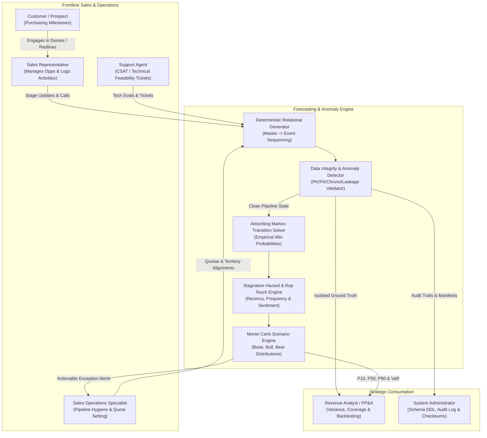
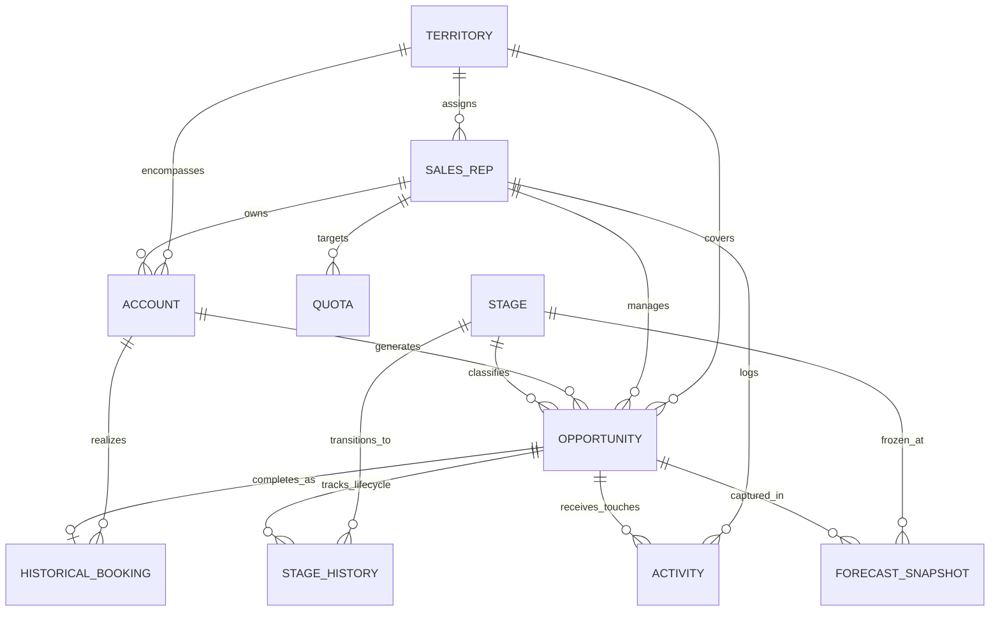
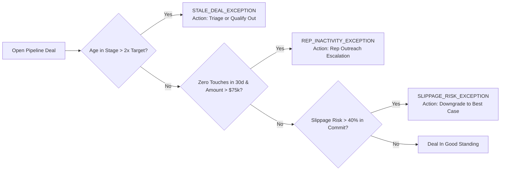

# System Architecture & Mathematical Specification

## 1. Primary Actors & System Interactions

The Bookings Forecasting Engine bridges commercial frontline execution, executive governance, and quantitative sales operations:



---

## 2. Entity-Relationship Model & Cardinality

The schema guarantees referential integrity, historical traceability, and anti-leakage invariants across 10 core tables:



### Cardinality Summary
- **Territory to SalesRep**: $1 : N$ (Every rep belongs to exactly one territory; territories hold multiple reps across roles).
- **SalesRep to Account / Deal**: $1 : N$ (Primary rep owns accounts and associated opportunities).
- **Opportunity to StageHistory**: $1 : N$ (Immutable append-only state changes; state is never overwritten in place).
- **Opportunity to Activity**: $1 : N$ (Discretely timestamped events: Calls, Emails, Demos, Exec Meetings).
- **Opportunity to HistoricalBooking**: $1 : 0..1$ (Strict $1:1$ realization only when deal transitions to `STG-05-WON`).
- **Opportunity to ForecastSnapshot**: $1 : N$ (Time-series freeze at monthly/quarterly boundaries; prior states preserved).

---

## 3. Mathematical Formulation of the Forecasting Engine

### 3.1 Absorbing Markov Chain Deal Conversion
Let the sales process be represented as a discrete-time Markov chain with state space $S = T \cup A$:
- **Transient States ($T$)**: $S_1 = \text{Prospecting}, S_2 = \text{Discovery}, S_3 = \text{Proposal}, S_4 = \text{Negotiation}$.
- **Absorbing States ($A$)**: $S_5 = \text{Closed Won}, S_6 = \text{Closed Lost}$.

From empirical transitions in `StageHistory`, transition counts $C_{ij}$ define the transition matrix $P$:
$$P = \begin{pmatrix} Q & R \\ 0 & I \end{pmatrix}$$
where:
- $Q$ is the $|T| \times |T|$ matrix of transitions among open pipeline stages.
- $R$ is the $|T| \times |A|$ matrix of transitions from transient stages to terminal outcomes.
- $I$ is the identity matrix representing absorption ($\text{Closed Won}$ and $\text{Closed Lost}$ are terminal).

The **Fundamental Matrix** $N$:
$$N = (I - Q)^{-1} = \sum_{k=0}^{\infty} Q^k$$
where $N_{ij}$ denotes the expected number of times a deal spends in stage $j$ given starting stage $i$.

The **Absorption Probability Matrix** $B$:
$$B = N R = (I - Q)^{-1} R$$
The entry $B_{i, \text{Won}}$ yields the exact, multi-hop empirical probability that an opportunity starting in stage $i$ successfully closes as Won.

```
Empirical Absorption Probabilities (Full Scale Fit):
- STG-01-PROSPECT   --> Won: 27.4%
- STG-02-DISCOV     --> Won: 32.8%
- STG-03-PROP       --> Won: 44.2%
- STG-04-NEGOT      --> Won: 53.3%
- STG-05-WON        --> Won: 100.0%
- STG-06-LOST       --> Won: 0.0%
```

---

### 3.2 Rep Activity Engagement Index
Discrete interactions logged in the 30-day window preceding snapshot date $T_{\text{snapshot}}$ are weighted by impact and sentiment:

$$\text{Raw Activity Score} = \sum_{a \in \mathcal{A}_{30}} w(a) \times \left(1.0 + 0.5 \times s(a)\right)$$

where weights $w(a)$ reflect decision acceleration:
- `Executive Meeting`: $4.5$
- `Technical Evaluation`: $4.0$
- `Product Demo`: $3.0$
- `Phone Call`: $1.0$
- `Email`: $0.5$
- $s(a) \in [-1.0, 1.0]$ is the interaction sentiment.

The raw score maps nonlinearly to the rep activity multiplier $M_{\text{act}} \in [0.65, 1.30]$:
$$M_{\text{act}} = \text{clamp}\left(0.70 + 0.55 \left(1.0 - \exp\left(-\frac{\text{Score}}{8.0}\right)\right), 0.65, 1.30\right)$$
Deals with **zero touches in 30 days** receive an automatic neglect penalty ($M_{\text{act}} = 0.65$).

---

### 3.3 Deal Age & Stagnation Hazard Function
For a deal in stage $s$ with elapsed stage duration $\tau_{\text{deal}}$ versus target duration $D_s$:
$$\text{Hazard Ratio} = \max\left(0, \frac{\tau_{\text{deal}} - D_s}{D_s}\right)$$
$$\text{Decay Factor } H(\tau) = \exp\left(-0.25 \times \text{Hazard Ratio}\right)$$
Clamped to $[0.40, 1.00]$. Deals exceeding $2.0 \times D_s$ or $>60$ days are flagged as `STALE_DEAL_EXCEPTION`.

---

### 3.4 Opportunity Calibrated Win Probability
Combining Markov conversion, engagement uplift, and stagnation hazard:
$$P_{\text{win}}(\text{deal}) = \text{clamp}\left(B_{\text{stage}, \text{Won}} \times M_{\text{act}} \times H(\tau), 0.02, 0.98\right)$$

---

### 3.5 Scenario-Based Uncertainty & Monte Carlo Simulation
Pipeline uncertainty is modeled through three macro scenarios:

| Parameter | Base Scenario | Bull Scenario | Bear Scenario |
| :--- | :--- | :--- | :--- |
| **Win Multiplier** | $1.00 \times$ | $1.15 \times$ | $0.75 \times$ |
| **Slippage Hazard** | Baseline empirical | $0.75 \times$ (-25% slippage) | $1.40 \times$ (+40% slippage) |
| **Procurement Cycle** | Standard | -12% acceleration | +25% delay |

In each Monte Carlo iteration $k \in \{1, \dots, 500\}$:
1. Deal slippage is sampled: $u_{\text{slip}} \sim \text{Uniform}(0, 1)$. If $u_{\text{slip}} < P_{\text{slip}}$, deal slips beyond quarter end.
2. If staying in quarter, conversion is evaluated: $u_{\text{win}} \sim \text{Uniform}(0, 1)$. If $u_{\text{win}} < P_{\text{win}}$, deal is Won with value $V_i = \text{amount\_usd}_i$.
3. Total quarterly booking: $B_k = \sum_i V_{k, i}$.

From empirical distribution $\{B_1, \dots, B_N\}$, the engine computes:
- **$P_{10}$ (Conservative / Floor)**: 10th percentile
- **$P_{50}$ (Expected Median)**: 50th percentile
- **$P_{90}$ (Optimistic Ceiling)**: 90th percentile
- **Value at Risk ($VaR_{95}$)**: Downside risk shortfall $P_{50} - P_{05}$.

---

## 4. Operational Exceptions & Triage Taxonomy


